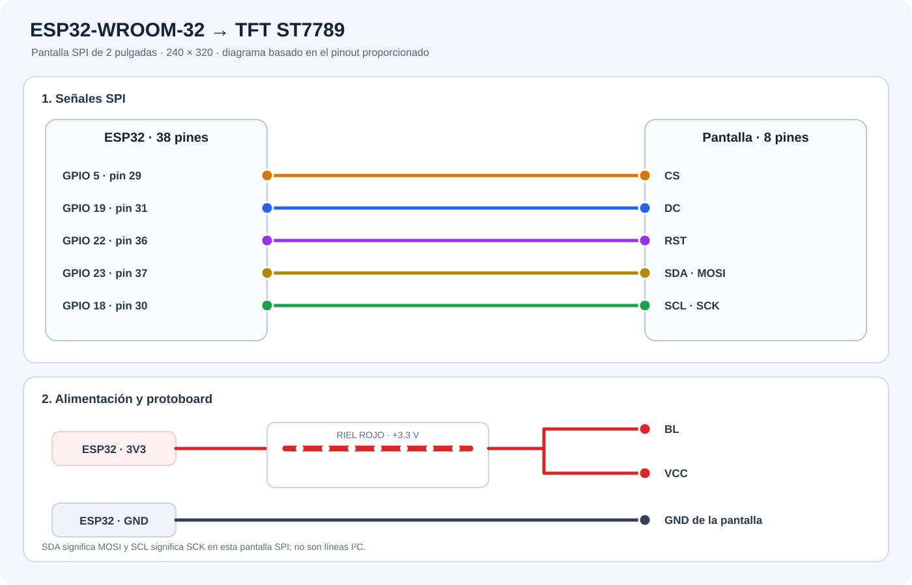

# ESP32 TFT Demo

Demo de una boca animada para una ESP32-WROOM-32 y una pantalla TFT ST7789 GMT020-02-8P. La interfaz web anima la boca con el micrófono, reproduce voz, muestra imágenes adaptadas a la pantalla y permite cambiar la orientación vertical u horizontal.

## Diagrama de conexión

## Inicio rápido

1. Instala Arduino IDE, el paquete de placas **ESP32 by Espressif Systems** y las bibliotecas **Adafruit GFX Library** y **Adafruit ST7735 and ST7789 Library**.
2. Conecta la TFT según el diagrama y la tabla del [manual](docs/MANUAL.md).
3. Abre `firmware/esp32_tft_mouth.ino` en Arduino IDE, selecciona la placa y el puerto, y cárgalo en el ESP32.
4. En macOS, la primera vez ejecuta `chmod +x iniciar-mac.command` en Terminal y luego abre el archivo. En Windows, ejecuta `iniciar-windows.bat`. Ambos requieren Python 3.
5. Abre `http://127.0.0.1:8765/` en Chrome o Edge y pulsa **Conectar ESP32 por USB**.
6. Selecciona el puerto USB de la placa. Prueba **Mostrar boca**, **Usar micrófono** o carga una imagen.

El manual explica tecnologías, instalación, conexión y solución de problemas: [docs/MANUAL.md](docs/MANUAL.md).

## Tecnologías

- HTML, CSS y JavaScript sin framework ni compilación.
- Web Serial API para comunicarse con el ESP32 por USB desde Chrome o Edge.
- Web Audio API para analizar localmente el micrófono y animar la boca.
- Canvas para adaptar las imágenes y convertirlas al formato de color de la TFT.
- Python 3 (`http.server`) para servir la web en `localhost`; no hay backend ni Docker.
- Arduino C++ con Adafruit GFX y Adafruit ST7789 para dibujar en la TFT.
- HEIC/HEIF se decodifica en el navegador con `heic2any` 0.0.4 desde cdnjs (se requiere Internet para cargar esta biblioteca).

El micrófono y las imágenes se procesan en el navegador. El nivel de audio se envía por USB; la demo no incluye una API ni almacena audio. La voz de muestra y el conversor HEIC se cargan desde Internet.
