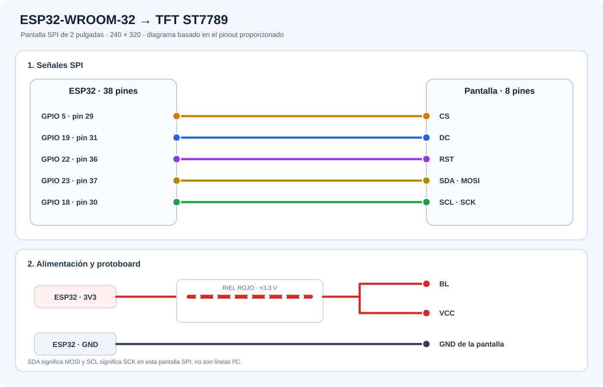

# Manual de ESP32 TFT Demo

## 1. Qué hace

La aplicación muestra una boca animada en una TFT ST7789 y en el navegador. Puede moverla con el micrófono del computador, reproducir voz desde el navegador, cargar imágenes y cambiar entre orientación vertical y horizontal. El ESP32 recibe comandos y bloques de imagen por USB serie.

## 2. Hardware compatible

- ESP32-WROOM-32 de 38 pines.
- Pantalla SPI GMT020-02-8P de 2 pulgadas con controlador ST7789, 240 × 320.
- Cable USB con datos.

## 3. Diagrama y cableado



| Pin TFT | ESP32 | Descripción |
| --- | --- | --- |
| BL | 3V3 | Retroiluminación |
| CS | GPIO 5 | Selección de pantalla SPI |
| DC | GPIO 19 | Selección datos/comandos |
| RST | GPIO 22 | Reinicio de pantalla |
| SDA | GPIO 23 | MOSI, datos SPI |
| SCL | GPIO 18 | SCK, reloj SPI |
| VCC | 3V3 | Alimentación de pantalla |
| GND | GND | Tierra común |

En esta pantalla SPI, `SDA` y `SCL` significan `MOSI` y `SCK`; no son I²C. Conecta `BL` y `VCC` a **3.3 V**, nunca a 5 V. Puedes llevar 3V3 al riel rojo de la protoboard y desde ahí a BL y VCC. El GND de la pantalla debe conectarse a GND del ESP32.

## 4. Tecnologías

- **Interfaz:** HTML, CSS y JavaScript nativos; no hay framework ni compilación.
- **USB serie:** Web Serial API. Requiere Chrome o Edge de escritorio y una página servida desde `localhost`.
- **Audio:** Web Audio API analiza localmente el micrófono y calcula el nivel que controla la boca. La aplicación no guarda ni sube el audio.
- **Imágenes:** Canvas adapta archivos a 240 × 320 o 320 × 240, convierte los píxeles a RGB565 y los envía en bloques al ESP32.
- **HEIC/HEIF:** `heic2any` 0.0.4 se carga desde cdnjs en el navegador; se necesita Internet al abrir la demo para convertir estos formatos. El resto de la interfaz funciona localmente.
- **Servidor local:** Python 3 estándar ejecuta `http.server` en `127.0.0.1:8765`. No requiere Docker, npm ni backend.
- **Firmware:** Arduino C++ con `Adafruit GFX Library` y `Adafruit ST7735 and ST7789 Library`. SPI controla la pantalla y USB serie funciona a 460800 baudios.

## 5. Preparar y cargar el firmware

1. Instala [Arduino IDE](https://www.arduino.cc/en/software).
2. En el Gestor de placas de Arduino IDE, instala **esp32 by Espressif Systems**.
3. En el Gestor de bibliotecas, instala **Adafruit GFX Library** y **Adafruit ST7735 and ST7789 Library**.
4. Conecta el ESP32 con un cable USB de datos.
5. Abre `firmware/esp32_tft_mouth.ino`.
6. Selecciona la placa ESP32 correspondiente y el puerto USB correcto.
7. Pulsa **Subir**. Al terminar, el firmware dibuja la boca cerrada.

## 6. Ejecutar la aplicación

### macOS

1. La primera vez, abre Terminal en la carpeta del proyecto y ejecuta `chmod +x iniciar-mac.command`. Después puedes abrir `iniciar-mac.command` desde Finder; si macOS lo bloquea, haz clic derecho y elige **Abrir**.
2. Deja abierta la ventana de Terminal: mantiene activo el servidor web.
3. En Chrome o Edge, abre `http://127.0.0.1:8765/`.

### Windows

1. Instala Python 3 si aún no está instalado.
2. Ejecuta `iniciar-windows.bat`.
3. Deja abierta la ventana del servidor.
4. En Chrome o Edge, abre `http://127.0.0.1:8765/`.

### Conectar y usar

1. Pulsa **Conectar ESP32 por USB** y autoriza el acceso al puerto serie.
2. Selecciona el puerto asociado a la placa ESP32.
3. Pulsa **Mostrar boca** para volver a la animación después de una imagen o prueba de color.
4. Para animar con la voz, pulsa **Usar micrófono** y autoriza el permiso del navegador. Para música de una pestaña, comparte su audio con la opción **Audio de pestaña**.
5. Usa los controles de orientación y ajuste de imagen para adaptar la pantalla.
6. Carga una imagen común. Para HEIC/HEIF, confirma que el equipo tenga Internet para cargar el decodificador.

## 7. Solución de problemas

- **Solo hay retroiluminación, no imagen:** revisa CS=GPIO 5, DC=GPIO 19, RST=GPIO 22, SDA/MOSI=GPIO 23 y SCL/SCK=GPIO 18.
- **La pantalla no enciende:** verifica BL y VCC en 3V3 y GND común. No conectes VCC a VIN/5V.
- **El navegador no ofrece conexión USB:** usa Chrome o Edge de escritorio, confirma que el servidor sigue activo en localhost y cierra otras aplicaciones que estén usando el puerto serie.
- **No aparece el puerto ESP32:** prueba un cable USB de datos, vuelve a conectar la placa y recarga la página.
- **El micrófono no funciona:** comprueba el permiso de micrófono del navegador y el dispositivo seleccionado en el computador.
- **La imagen no se ve:** pulsa **Mostrar boca** y vuelve a enviar la imagen; verifica que el firmware TFT esté cargado.
- **HEIC no convierte:** revisa la conexión a Internet y que cdnjs no esté bloqueado por la red.

## 8. Estructura

```text
.
├── README.md
├── docs/
│   ├── MANUAL.md
│   └── diagramas/diagrama_esp32_tft.svg
├── firmware/esp32_tft_mouth.ino
├── web/index.html
├── iniciar-mac.command
└── iniciar-windows.bat
```
